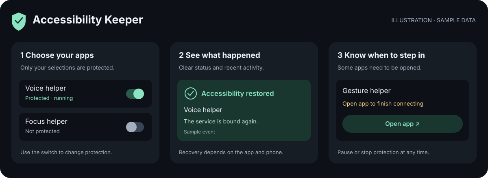

# Accessibility Keeper

Keep the accessibility apps **you choose** running.

<picture>
  <source media="(max-width: 640px)" srcset="docs/media/overview-mobile.svg">
  
</picture>

> **Public beta preparation:** signed public downloads are not available yet. The source can be built now. Compatibility is confirmed on **POCO F6 · HyperOS 3 · Android 16**; other devices need testing.

Keeper finds your installed accessibility services and attempts to restore the ones you protect when they stop. Some apps still need to be opened to finish connecting.

## Start here

| I want to… | Go to |
| --- | --- |
| Install and set up Keeper | [Step-by-step installation](docs/INSTALL.md) |
| Understand permissions or stop protection | [Safety and permissions](docs/SAFETY.md) |
| Report a bug or suggest something | [Open an issue](https://github.com/Soham-Rao/hyperos-accessibility-keeper/issues/new/choose) |
| Check compatibility or help test | [Testing and known limitations](docs/TESTING.md) |
| Build, fork or change the app | [Developer guide](docs/DEVELOPMENT.md) · [Contributing](CONTRIBUTING.md) |
| Find published APKs when available | [Releases](https://github.com/Soham-Rao/hyperos-accessibility-keeper/releases) |

## Everyday use

1. **Choose apps:** turn on their protection switches. New apps start unselected.
2. **Let Keeper help:** check the running status or Recent activity. Tap an app tile for options.
3. **Stay in control:** pause all recovery, or turn off a protection switch before deliberately disabling that service in Android Settings.

**Switch off means stop protection.** It leaves the service's existing Android accessibility setting unchanged. Keeper never starts clicking or opens another app without your action.

## Before granting access

Keeper uses powerful setup permissions to **monitor and restore/rebind your selected services**. Only protect third-party accessibility apps you trust. Read [what each permission does](docs/SAFETY.md) before setup. Recovery is best effort; it is not guaranteed across all apps or HyperOS versions.

## Credits

Maintained by [Soham-Rao](https://github.com/Soham-Rao). Based on [HyperOS Accessibility Guard by haku4130](https://github.com/haku4130/hyperos-accessibility-guard), with the original [MIT license](LICENSE) retained. This fork adds selectable multi-app protection, a redesigned interface, safer list-preserving recovery and an opening-required fallback. No upstream or device-vendor endorsement is implied.

[Fork changes](CHANGES.md) · [Third-party notices](THIRD_PARTY_NOTICES.md) · [Source provenance](docs/provenance/README.md)

[Privacy](PRIVACY.md) · [Terms](TERMS.md) · [Security](SECURITY.md) · [Permission guide](docs/PERMISSIONS.md)

[Audit findings and remaining release checks](docs/AUDIT.md)

[Device compatibility](docs/COMPATIBILITY.md) · [Release preparation](docs/RELEASE.md)
